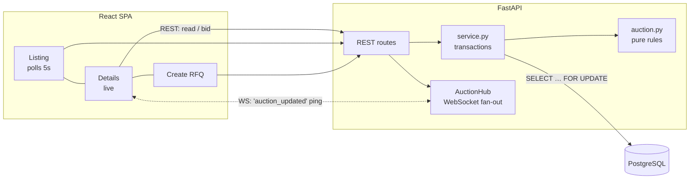
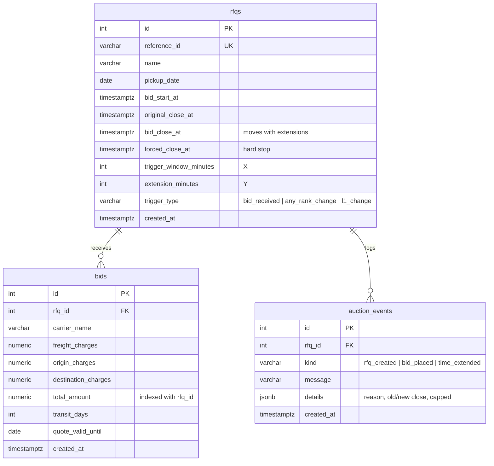

# British Auction RFQ

A reverse ("British") auction for freight RFQs. Suppliers bid openly and keep undercutting each other. Late activity automatically extends the auction, and a hard **forced close** guarantees it ends.

**Stack:** FastAPI · SQLAlchemy 2 · PostgreSQL · React 18 + TypeScript · WebSockets · Docker

```bash
docker compose up --build                            # http://localhost:8000
docker compose exec app python -m app.seed           # demo auctions: live, force-closed, closed, scheduled
```

<details><summary>Run without Docker (SQLite, zero setup)</summary>

```bash
cd backend  && pip install -r requirements.txt && python -m app.seed && uvicorn app.main:app --reload
cd frontend && npm install && npm run dev            # http://localhost:5173 (proxies /api to :8000)
cd backend  && python -m pytest                      # 14 tests
```
</details>

---

## 1. High-level design



**Placing a bid** is the interesting path:

```mermaid
sequenceDiagram
    participant S as Supplier
    participant API
    participant DB as PostgreSQL
    participant W as Other viewers
    S->>API: POST /api/rfqs/{id}/bids
    API->>DB: BEGIN; SELECT rfq FOR UPDATE   (bids on this RFQ now serialised)
    API->>API: status == active? beats own previous bid?
    API->>API: ranking before → insert bid → ranking after
    API->>API: in trigger window AND trigger condition met?<br/>close = min(close + Y, forced_close)
    API->>DB: INSERT bid, events; UPDATE bid_close_at; COMMIT
    API-->>S: 201 + full auction state
    API--)W: WS ping → clients refetch
```

### Key design decisions

| Decision | Why |
|---|---|
| **Row lock per auction** (`SELECT … FOR UPDATE`) | Two suppliers bidding in the same second must not both read the old ranking or both extend from the same close time. Bids on *different* RFQs never block each other. |
| **Status is derived from time, not stored** | `scheduled / active / closed / force_closed` is a pure function of `now` and the four timestamps, so there's no cron job, no Celery and no "close the auction" race. An auction closes at exactly its close time, even with zero traffic. |
| **Rules isolated in `auction.py`** | Ranking, trigger detection and capping are pure functions with no DB, unit-tested in milliseconds. `service.py` only orchestrates. |
| **Injectable clock** | `now` is a FastAPI dependency. Tests time-travel through a full auction, and the seed script replays real bids at back-dated times so its extensions come from the real rules. |
| **WebSocket sends a ping, not a payload** | Clients refetch over REST on ping. One source of truth, and a dropped message or reconnect can't leave a stale leaderboard. |
| **Server-time sync** | Every response carries `server_time`, and the countdown corrects for the browser's clock drift. In a closing auction, a skewed laptop clock would otherwise show the wrong deadline. |
| **Rules enforced twice** | Pydantic validates requests (`forced_close > close`), and DB `CHECK` constraints (`bid_close_at <= forced_close_at`) make the invariant hold even against a buggy future code path. |

### Auction rules as implemented

- **Trigger window** is `[close − X, close)`. It moves with each extension.
- **Extension:** `new_close = min(current_close + Y, forced_close)`. Once at the forced close, further triggers are logged as bids but can't extend.
- **Triggers:**
  - *Bid received*: any bid in the window.
  - *Any rank change*: some supplier's position changed. A newcomer landing at the bottom displaces no one and doesn't count.
  - *L1 change*: the lowest bidder is a different supplier. The first bid creates an L1, so it counts.
- **Ranking:** each supplier's best total (`freight + origin + destination`), lowest first. Equal prices go to whoever bid first.
- **Bidding:** a supplier's new bid must undercut their own previous best. They don't have to beat L1, because a better L3 bid is still useful to the buyer.
- **Force Closed** means the auction was extended all the way to the hard stop. **Closed** means it ended at a natural (possibly extended) close.

## 2. Schema



- **Constraints:** `bid_start_at < original_close_at < forced_close_at`, `bid_close_at <= forced_close_at`, positive X/Y and totals.
- **Index:** `(rfq_id, total_amount)` serves both the listing's lowest-bid aggregate and the ranking.
- **Bids are append-only.** Full bid history is kept for audit, and the ranking uses each supplier's best bid.
- **`original_close_at` is kept** so the UI can show how much time the extensions added.
- **Money** is `NUMERIC` end to end, sent as decimal strings, and never a float.

## 3. API

| Method | Path | |
|---|---|---|
| `GET` | `/api/rfqs` | Listing: lowest bid, current and forced close, status |
| `POST` | `/api/rfqs` | Create an RFQ with its auction config |
| `GET` | `/api/rfqs/{id}` | Details: ranking, quotes, config, activity log, stats |
| `POST` | `/api/rfqs/{id}/bids` | Place a bid. Returns `409` if the auction is closed or the bid doesn't beat the supplier's own best |
| `WS` | `/api/rfqs/{id}/live` | Push notifications for that auction |

Interactive docs are at `/docs`.

## 4. Frontend

- **Listing:** every auction with its live countdown and status badge.
- **Details:**
  - The **timeline bar** shows start → original close → extended close → forced close, plus the live trigger window, so the British-auction mechanics are visible at a glance.
  - The countdown turns amber inside the trigger window and pulses when the auction is extended.
  - The L1–Ln ranking shows the full quote breakdown.
  - The activity log gives the reason for each extension.
  - Stats map to the brief's **success metrics**: bids per RFQ and price improvement over the opening bid.
- **Create:** validates "forced close > bid close" inline before submit. The server validates again.

## 5. Deliberately not built

The JD lists more technology than this problem needs. I left out:

- **Celery / Redis queue.** Nothing here is asynchronous work. Closing is derived from time, so a scheduler would add a failure mode and no value. *When it would be needed:* "notify suppliers when outbid" (email/SMS) belongs in a Celery task.
- **Redis pub/sub for WebSockets.** The hub is in-process, which is correct for one API worker. Swap it for Redis pub/sub before running several replicas; the hub's interface stays the same.
- **Auth.** A supplier is identified by carrier name. In production this comes from the authenticated supplier account, so a typo can't create a new supplier.
- **Migrations.** Tables come from `create_all`. Alembic is the next step once the schema has to evolve on live data.
- **Neo4j.** There's no graph-shaped data here.
